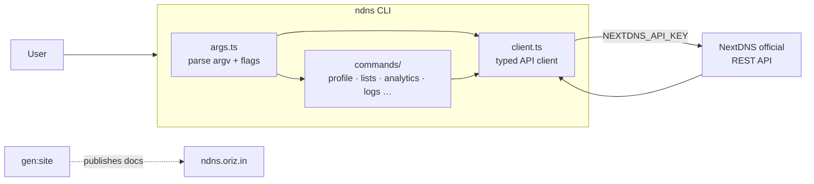

# ndns

> Complete NextDNS account CLI — full official-API coverage in a single-file TypeScript binary. Runs on Deno or Bun.

[](LICENSE)
[](https://github.com/chirag127/ndns/stargazers)
[](https://github.com/chirag127/ndns/commits)
[](https://deno.com)
[](https://bun.sh)
[](https://www.npmjs.com/package/@chirag127/ndns)
[](https://github.com/chirag127/ndns/actions/workflows/ci.yml)

**Docs + command reference:** <https://ndns.oriz.in> · **Repo:** <https://github.com/chirag127/ndns>

ndns drives your entire NextDNS account from the terminal — profiles, deny/allow lists, blocklists, native tracker feeds, security & parental controls, privacy toggles, analytics, and live logs. It fills the gap left by `nextdns/nextdns` (forwarder-only) and third-party libraries (all narrow or stale) by covering the **full official REST API** in one dependency-light TypeScript file.

⭐ If this is useful, please [star the repo](https://github.com/chirag127/ndns/stargazers) — it helps others find it.

## Beta notice

The NextDNS API is **BETA** and subject to breaking changes. See the [official docs](https://nextdns.github.io/api). Report breakage via GitHub issues.

## How it works



## Features

- **Full official-API coverage** — profiles, denylist/allowlist, blocklists, native feeds, security, parental controls, privacy, settings, analytics (11 endpoints), logs (incl. SSE stream), and config export/import.
- **Two runtimes** — install via Deno or Bun, or grab a prebuilt binary from GitHub Releases.
- **Single-file TS** — easy to audit, easy to vendor.
- **Flexible output** — `table`, `json`, or `csv` for every command.
- **Time-series analytics** — `--series` with configurable interval + timezone.
- **Backup/restore** — full profile config export and import.
- **Bulk workflows** — import/export deny/allow lists (see `examples/`).

## Tech stack

- **[Deno](https://deno.com) 2.9+** / **[Bun](https://bun.sh) 1.3+**
- **TypeScript** — single-file entry (`src/mod.ts`)
- `@std/*` (Deno standard library) + `@deno/gfm` (docs-site generation)
- Published to **npm** as [`@chirag127/ndns`](https://www.npmjs.com/package/@chirag127/ndns)

## Repo structure

```
src/
├── mod.ts          # entry point
├── args.ts         # argv + flag parsing
├── client.ts       # typed NextDNS REST client
├── commands/       # one module per command group
└── util/           # shared helpers
examples/           # bulk-import-hagezi.sh, daily-summary.sh, sync-two-profiles.sh
.github/workflows/  # ci, pages (docs → ndns.oriz.in), release, prerelease
```

## Install

```bash
# Deno (recommended)
deno install -grf --allow-net --allow-env --allow-read --allow-write \
  -n ndns https://raw.githubusercontent.com/chirag127/ndns/main/src/mod.ts

# Bun
bun install -g @chirag127/ndns

# Binary — download from GH releases
# https://github.com/chirag127/ndns/releases
```

## Auth

Set `NEXTDNS_API_KEY`. Get a key at [my.nextdns.io/account](https://my.nextdns.io/account).

```bash
# bash/zsh
export NEXTDNS_API_KEY='<your-key>'

# PowerShell
$env:NEXTDNS_API_KEY = '<your-key>'
```

Store it in a password manager, not shell history.

### Configuration

| Env var | Purpose |
|---|---|
| `NEXTDNS_API_KEY` | NextDNS account API key — required for all commands |

## Quick start

```bash
ndns whoami                                        # verify key
ndns profile list                                  # list profiles
ndns denylist add <profile> ads.example.com        # add domain
ndns analytics status <profile> --from=-24h        # last-24h stats
ndns logs stream <profile>                          # live tail
```

## Commands

| Command | Purpose |
| --- | --- |
| `whoami` | Verify API key + list profiles |
| `profile <list\|show\|create\|update\|delete>` | Profile CRUD |
| `denylist <list\|add\|remove\|toggle-active\|bulk-add\|bulk-remove\|export\|import>` | Block domains |
| `allowlist <...>` | Same shape as denylist |
| `blocklist <list-available\|list\|subscribe\|unsubscribe>` | Curated blocklists |
| `native <list\|add\|remove>` | Native tracker feeds (Apple/Google/etc.) |
| `security <show\|set\|tld>` | Threat protection settings |
| `parental <show\|safe-search\|youtube-restricted\|block-bypass\|services\|categories>` | Parental control |
| `privacy <show\|set>` | Privacy toggles |
| `settings <show\|logs\|blockpage\|performance>` | Profile settings |
| `analytics <resource> <profile>` | 11 endpoints, time-series via `--series` |
| `logs <list\|stream\|download\|clear>` | Query logs, SSE stream |
| `config <export\|import>` | Full profile backup / restore |

## Flags

| Flag | Meaning |
| --- | --- |
| `--output=<table\|json\|csv>` | Output format (default: table for lists, json for objects) |
| `--from=<date>` | ISO 8601, unix seconds, unix ms, or relative (`-6h`, `-1d`, `-7d`) |
| `--to=<date>` | Same as `--from` |
| `--limit=<n>` | 1-500 for analytics, 10-1000 for logs |
| `--device=<id>` | Filter by device ID (or `__UNIDENTIFIED__`) |
| `--search=<text>` | Log/analytics search |
| `--series` | Analytics time-series mode |
| `--interval=<1d\|1h\|30m>` | Series bucket size |
| `--timezone=<IANA>` | e.g. `America/New_York` |

## Examples

See [examples/](./examples/):

- `bulk-import-hagezi.sh` — import hagezi blocklist as a denylist
- `daily-summary.sh` — daily analytics summary via jq
- `sync-two-profiles.sh` — copy config A → B

## Part of the oriz family

ndns is one of ~80 [oriz](https://blog.oriz.in) projects. The CLI **runs locally, no server**; the docs site at [ndns.oriz.in](https://ndns.oriz.in) is hosted for **$0 on the Cloudflare free tier**.

## Contributing

Issues + PRs welcome. Terse issues preferred: what happened, what you expected, your env. Conventional commits are the changelog.

## Status

Beta — tracks the NextDNS API (itself beta). API coverage is complete; expect churn as NextDNS evolves.

## License

MIT © 2026 Chirag Singhal · chirag@oriz.in — see [LICENSE](LICENSE).
